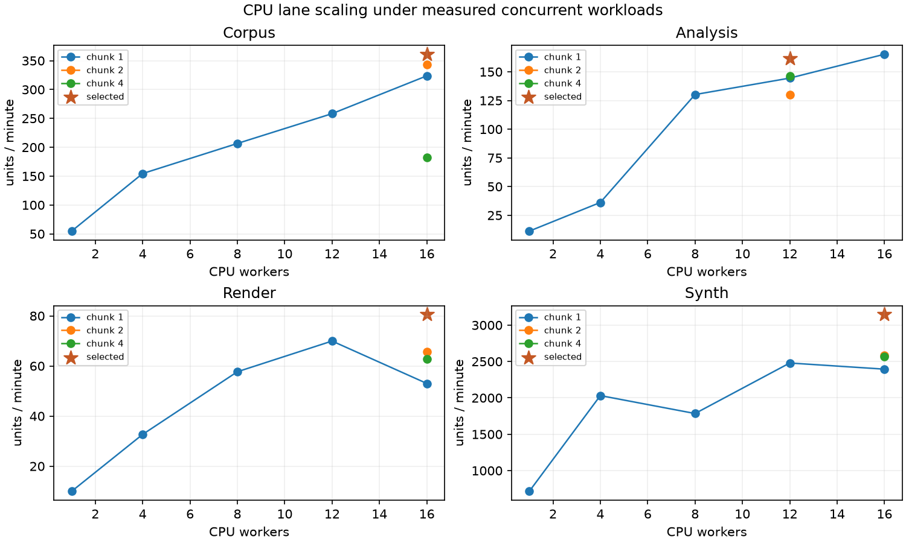

# CPU and Intel lane measurements

Generated 2026-10-29T04:09:57+00:00 from local measured artifacts.

Peak sequence phase: **sustain**. Agent: `gpt-sol`, branch `dev`.

## Hardware and method

Intel Core Ultra 9 185H, 22 logical / 16 physical cores, Intel Arc iGPU, Intel AI Boost NPU, 23.4 GiB RAM and NVMe. The NVIDIA lane belongs to opus-cc. The configured CPU budget is 17 workers, or 16 while the Intel lane borrows one host thread. Native math threads are limited to one per worker; multiprocessing uses spawn. The Windows power plan was Balanced at bootstrap; no power, firmware, driver, fan or clock settings were changed by this lane.

Measurements exclude worker warm-up in the tuner. Every timed CPU unit forces actual work; cache hits are not counted as compute. Full-corpus analysis is resumable and its elapsed time covers the completed invocation after the checkpointed algorithm restart. Host CPU, RAM and disk figures include concurrent agents and applications; process-tree RSS is separate. Missing temperature sensors are reported as unavailable. Throughput differences alone do not establish thermal or memory-bandwidth limits.

The first corpus run used the standalone 10 GiB disk floor while the shared guard was landing. Subsequent stages use remixer.guards in unleashed mode and atomic checkpoints. All audio generated here is synthetic; no real taste data is used by the heuristic or random MLP.

## Corpus

500 tracks; 29.94 hours; 639.16 wall seconds; **168.61 audio-seconds / wall-second**. Each has 44.1 kHz stereo PCM16 drums, bass, vocals-like lead, other, and their exact integer-summed mix, with seeded BPM, key and beat positions.

Host CPU mean 89.85%, peak 91.46%; process-tree RSS peak 1.21 GiB. Host write throughput 152.47 MB/s. Disk-floor stop: None; real library files registered: 0.

The original baseline uses procedural-v1. The current default generator also varies eight chord progressions, four kick/snare styles, note rests and hat velocities under procedural-v2. Legacy seed identities and bytes remain reproducible with --legacy-arrangement. Additional procedural-v2 validation tracks completed: 0; their track key accuracy: 0.00%; BPM MAE: unavailable.

## Analysis accuracy

Analyzed 2500 mixes/stems (500 tracks). Mean absolute BPM error: **0.276 BPM**. Exact tonic-and-mode accuracy: **100.00%**. Throughput 26.51 tracks/minute or 132.57 mixes/stems per minute; errors: 0.

Method: key from harmonic other stem, tempo from drums; no truth labels used during inference. Mix-only key accuracy remains 51.00%; mix-only BPM MAE 0.334. Post-analysis refinement took 308.18 seconds and is separate from the original throughput timing. Original baseline estimates are retained in data/analysis/baseline-v2.json.

## Tuning and knees

Knee: smallest worker count within 3% of the observed best. Confirmation stops after two successive rounds improve the previous best by less than 3%. Full-budget sustains use unrestricted scheduling; P/E affinity comparisons remain separate.

| Stage | Knee workers | Chunk | Affinity | Tuned units/min | Converged |
|---|---:|---:|---|---:|---|
| analysis | 12 | 1 | OS scheduler | 161.68 | True |
| corpus | 16 | 4 | OS scheduler | 361.10 | True |
| render | 16 | 1 | OS scheduler | 80.57 | True |
| synth | 16 | 1 | OS scheduler | 3,146.98 | True |

Topology discovery: P=[0, 1, 10, 11, 12, 13, 14, 15, 16, 17, 18, 19], E=[2, 3, 4, 5, 6, 7, 8, 9, 20, 21].

Every worker/chunk/affinity configuration and confirmation round is preserved in `data/cpu-peak/tuning/tuning.json`. Units are generated tracks, analyzed files, rendered recipes, or scored synth clips, respectively. The corpus tuning unit is a 20-second fresh track; analysis uses a complete corpus mix; render tuning uses a 10-second recipe; synth tuning scores one clip.

## Sustained CPU stages

| Stage | Workers | Seconds | Units/min | Host CPU mean / peak % | Tree RSS GiB | Host RAM GiB | Read / write MB/s |
|---|---:|---:|---:|---:|---:|---:|---:|
| corpus | 16 | 605.31 | 415.92 | 90.87 / 91.75 | 1.13 | 14.80 | 2.47 / 124.81 |
| analysis | 16 | 604.63 | 154.71 | 90.98 / 91.73 | 3.04 | 20.46 | 6.99 / 1.51 |

| Stage | NVIDIA observed samples | NVIDIA mean % | Samples above 90% | iGPU mean % |
|---|---:|---:|---:|---:|
| corpus | 21 | 0.00 | 0.00% | unavailable |
| analysis | 465 | 6.80 | 2.15% | 92.08 |

NVIDIA overlap is observed through NVML or the existing Windows PDH adapter. NVML can report Unknown when idle; PDH zeroes are retained as zeroes. Missing/partial sampling cannot certify a synchronized ten-minute GPU run. NPU has no Windows utilization counter here; device execution and inferences/second are recorded directly.


Render sustain uses cross-source recipes with loudness matching and actual Rubber Band processing. Synth sustain evolves full populations with selection, crossover and mutation, saves each generation, and exposes a FitnessScorer protocol for later taste-model integration.

## Intel device runs

| Mode | Requested / executed | Device | Seconds | Embeddings/s | Reference max error | Fallback |
|---|---|---|---:|---:|---:|---|
| per-device | NPU / NPU | Intel(R) AI Boost | 600.01 | 45,527.93 | 0.000355 | none |
| per-device | GPU.0 / GPU.0 | Intel(R) Arc(TM) Graphics (iGPU) | 600.00 | 84,806.27 | 0.000497 | none |
| per-device | CPU / CPU | Intel(R) Core(TM) Ultra 9 185H | 600.00 | 91,697.89 | 0.000000 | none |
| simultaneous async | NPU / NPU | Intel(R) AI Boost | 600.07 | 145,476.69 | 0.000355 | none |
| simultaneous async | GPU.0 / GPU.0 | Intel(R) Arc(TM) Graphics (iGPU) | 600.07 | 92,173.74 | 0.000497 | none |

The IR is a seeded 512→256→64→1 MLP with static batch 128. It is an untrained synthetic load/placement probe, not the owner's taste model. Device compilation and numeric validation are excluded from sustained timing. Simultaneous mode feeds bounded asynchronous request queues from one host loop. Intel GPU full names are validated before compilation; NVIDIA execution is excluded.

## Limits and remaining work

CPU temperatures and thermal-throttle attribution require an available sensor reader. Host disk rates are aggregate OS counters, not lane-isolated bandwidth. Worker sweeps identify scaling limits; they cannot alone distinguish memory bandwidth, cache, power limits and thermal throttling. The GPU coordinator's combined bench record is needed to certify a synchronized all-engines result. A held GPU lock proves ownership, not sustained GPU utilization. See `docs/PEAK_REPORT.md` for the coordinator's evidence.

## Reproduce

```powershell
uv run remixer corpus generate --n 500 --legacy-arrangement
uv run remixer analyze
uv run remixer analyze --queue
uv run remixer cpu tune --output data/cpu-peak/tuning
uv run remixer cpu sustain --output data/cpu-peak/sustain --tuning data/cpu-peak/tuning/tuning.json --seconds 600
uv run remixer npu --seconds 600
uv run python tools/corpus/report.py
uv run pytest
```

Acquire CPU/NPU locks through agentctl before heavy runs; the peak coordinator acquires GPU, CPU, NPU in that order. Use REMIXER_DATA_DIR for an alternate data root. Source music remains read-only.

## Versions

- numpy: 2.4.6
- scipy: 1.17.1
- soundfile: 0.14.0
- pyarrow: 26.0.0
- pedalboard: 0.9.26
- pyloudnorm: 0.2.0
- openvino: 2026.4.1



